# Software Engineering Methods

* Master Build Status [](https://github.com/kaungmyatlwin18/Group_11-DevOps/actions/workflows/main.yml)
* Develop Build Status [](https://github.com/kaungmyatlwin18/Group_11-DevOps/actions/workflows/main.yml)
* License [](https://github.com/kaungmyatlwin18/Group_11-DevOps/blob/master/LICENSE)
* Release [](https://github.com/kaungmyatlwin18/Group_11-DevOps/releases)

* Unit Testing [](https://github.com/kaungmyatlwin18/Group_11-DevOps/actions/workflows/unit-tests.yml)
* Integration Testing [](https://github.com/kaungmyatlwin18/Group_11-DevOps/actions/workflows/integration-tests.yml)
* Code Coverage Workflow [](https://github.com/kaungmyatlwin18/Group_11-DevOps/actions/workflows/code-coverage.yml)

# Group 11 — DevOps Project Report

**Module:** SET09803 DevOps
**Project:** Population Reporting System
**Code Review:** 2
**Evidence snapshot:** 25 November 2026 (`develop`, `64d6faf`)

## 1. Team Members

| Role | Member |
|---|---|
| Product Owner | Hein Htoo Naing |
| Scrum Master | Kaung Myat Lwin |
| Developer 1 | Htoo Aung Lin |
| Developer 2 | Nyan Lin Htet |
| Developer 3 | Dana Aung |
| Developer 4 | Thet Aung Hein |

## 2. Technologies Used

| Technology | Version / Details | Purpose |
|---|---|---|
| Java | JDK 25 (Eclipse Temurin) | Application development |
| Apache Maven | Maven 3.x | Build and test automation |
| MySQL | 8.4 | World population database |
| MySQL Connector/J | 26.7.0 | JDBC connectivity |
| Docker | Docker Desktop / Docker Compose | Containerised application and database |
| JUnit Jupiter | 5.11.4 | Automated tests |
| H2 | 2.3.232 | In-memory test database |
| JaCoCo | 0.8.16 | Code coverage |
| Git and GitHub | Version control and repository hosting | Issues, branches, pull requests and collaboration |
| GitHub Actions | CI workflows | Builds, tests, coverage and container verification |
| IntelliJ IDEA | Java IDE | Development and debugging |

## 3. Use Case Diagram

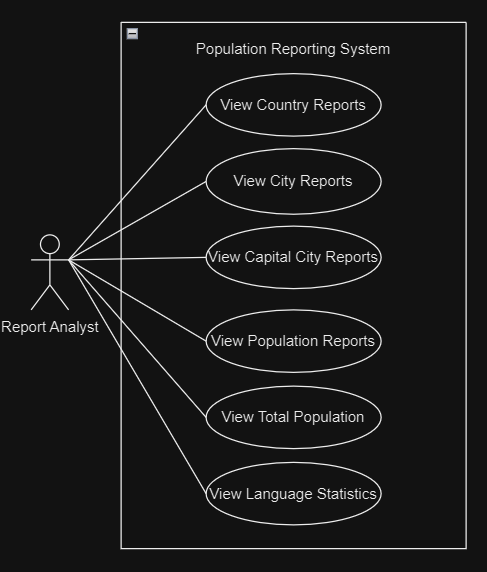

The console-based Population Reporting System generates reports using the MySQL World database. Reports cover countries, cities, capitals, population distribution, selected population totals and language statistics. Configurable location and Top N parameters support the relevant reports.

The existing overview diagram and [Sprint 1 detailed use cases](docs/use-case-diagram.md) are retained. The detailed use cases cover the six original country reports; their extension to the remaining features is subject to the team's documentation review.

## 4. Results and Outcomes

**32 of 32 functional requirements implemented (100%).** All feature issues are closed and their implementation PRs have been merged into `develop` as of the evidence snapshot. This is the development-branch status, not a new production release.

| Category | Implemented | Total |
|---|---:|---:|
| Country Reports | 6 | 6 |
| City Reports | 10 | 10 |
| Capital City Reports | 6 | 6 |
| Population Distribution Reports | 3 | 3 |
| Population Information | 6 | 6 |
| Language Statistics | 1 | 1 |
| **Total** | **32** | **32** |

Each row links to its issue, merged PR and actual console screenshot. Long report screenshots show representative visible rows rather than every result. Figures are from the supplied World database, not current demographic estimates. District totals represent recorded city populations in the selected district.

### 4.1 Country Reports

| ID | Requirement | GitHub Issue | Pull Request | Met? | Output Screenshot |
|---:|---|---|---|---|---|
| 1 | All countries in the world by population | [#2](https://github.com/kaungmyatlwin18/Group_11-DevOps/issues/2) | [#37](https://github.com/kaungmyatlwin18/Group_11-DevOps/pull/37) | Yes | [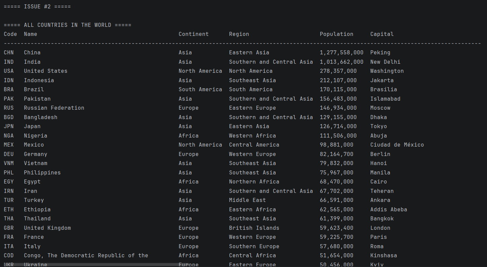](docs/screenshots/issue-02.png) |
| 2 | All countries in a continent by population | [#4](https://github.com/kaungmyatlwin18/Group_11-DevOps/issues/4) | [#37](https://github.com/kaungmyatlwin18/Group_11-DevOps/pull/37) | Yes | [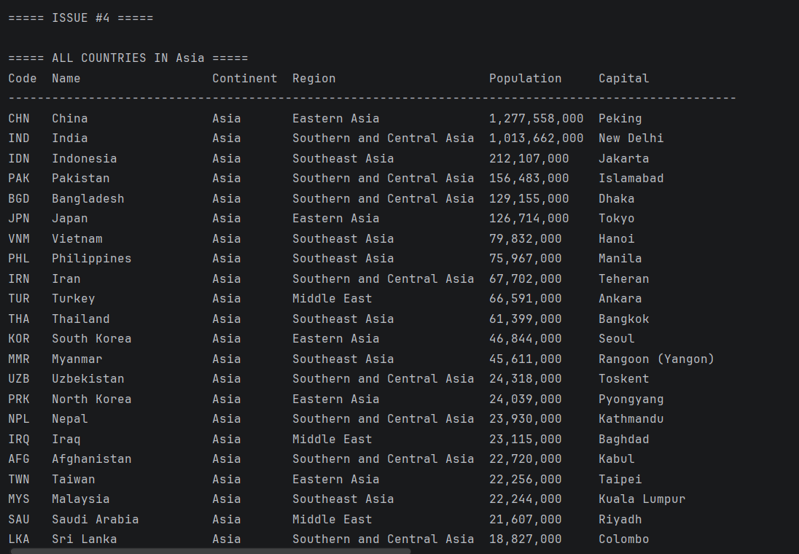](docs/screenshots/issue-04.png) |
| 3 | All countries in a region by population | [#6](https://github.com/kaungmyatlwin18/Group_11-DevOps/issues/6) | [#38](https://github.com/kaungmyatlwin18/Group_11-DevOps/pull/38) | Yes | [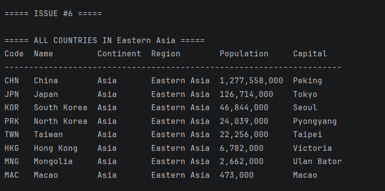](docs/screenshots/issue-06.png) |
| 4 | Top N countries in the world | [#7](https://github.com/kaungmyatlwin18/Group_11-DevOps/issues/7) | [#41](https://github.com/kaungmyatlwin18/Group_11-DevOps/pull/41) | Yes | [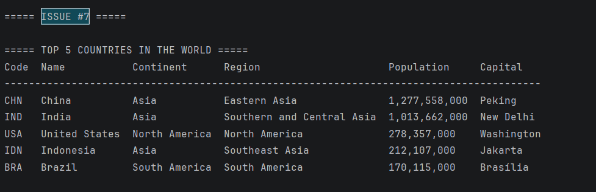](docs/screenshots/issue-07.png) |
| 5 | Top N countries in a continent | [#8](https://github.com/kaungmyatlwin18/Group_11-DevOps/issues/8) | [#40](https://github.com/kaungmyatlwin18/Group_11-DevOps/pull/40) | Yes | [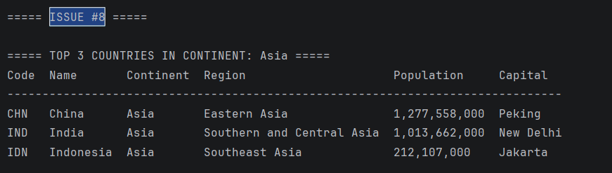](docs/screenshots/issue-08.png) |
| 6 | Top N countries in a region | [#9](https://github.com/kaungmyatlwin18/Group_11-DevOps/issues/9) | [#40](https://github.com/kaungmyatlwin18/Group_11-DevOps/pull/40) | Yes | [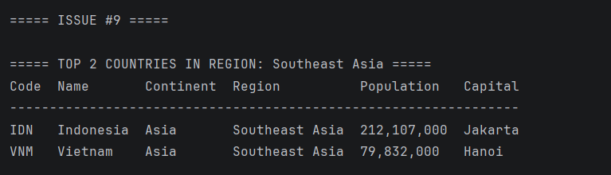](docs/screenshots/issue-09.png) |

### 4.2 City Reports

| ID | Requirement | GitHub Issue | Pull Request | Met? | Output Screenshot |
|---:|---|---|---|---|---|
| 7 | All cities in the world by population | [#10](https://github.com/kaungmyatlwin18/Group_11-DevOps/issues/10) | [#62](https://github.com/kaungmyatlwin18/Group_11-DevOps/pull/62) | Yes | [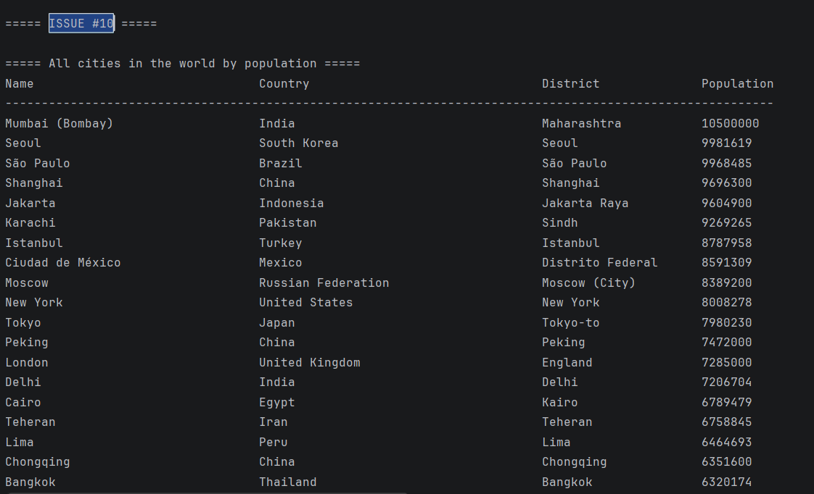](docs/screenshots/issue-10.png) |
| 8 | All cities in a continent by population | [#11](https://github.com/kaungmyatlwin18/Group_11-DevOps/issues/11) | [#63](https://github.com/kaungmyatlwin18/Group_11-DevOps/pull/63) | Yes | [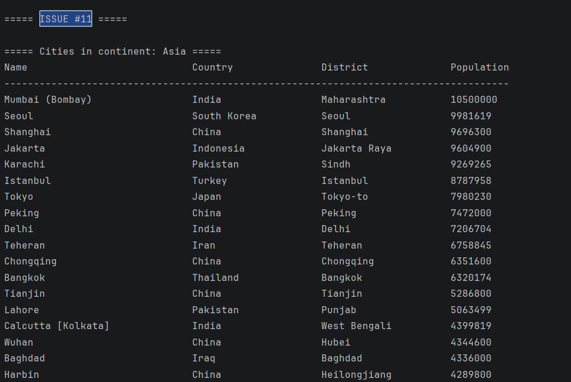](docs/screenshots/issue-11.png) |
| 9 | All cities in a region by population | [#12](https://github.com/kaungmyatlwin18/Group_11-DevOps/issues/12) | [#59](https://github.com/kaungmyatlwin18/Group_11-DevOps/pull/59) | Yes | [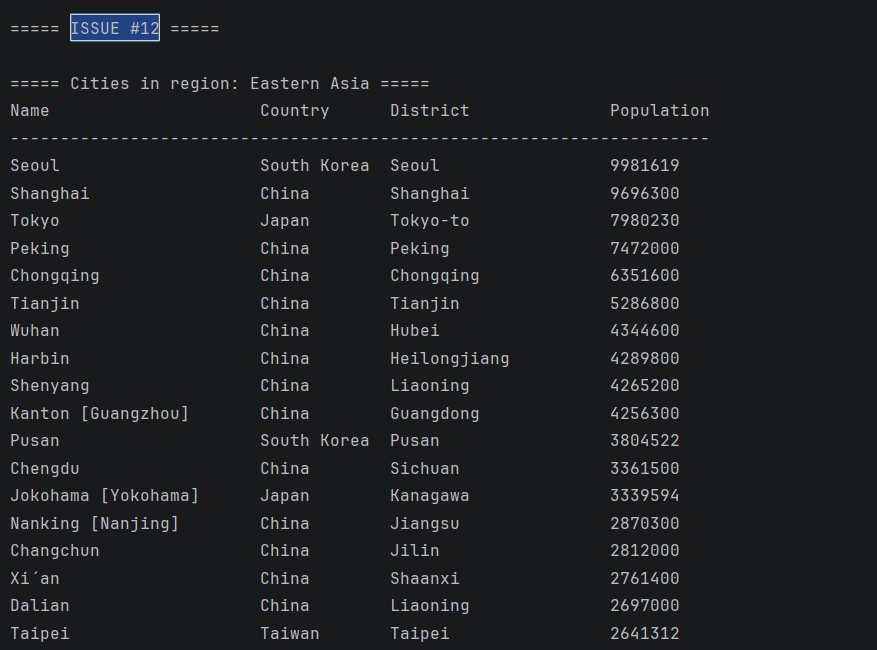](docs/screenshots/issue-12.png) |
| 10 | All cities in a country by population | [#13](https://github.com/kaungmyatlwin18/Group_11-DevOps/issues/13) | [#60](https://github.com/kaungmyatlwin18/Group_11-DevOps/pull/60) | Yes | [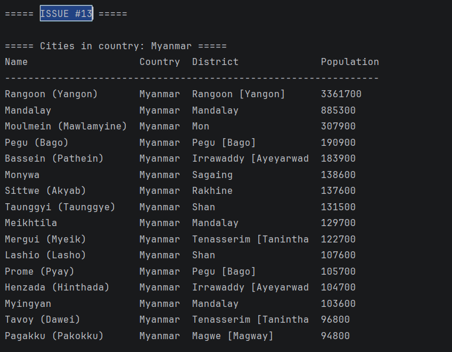](docs/screenshots/issue-13.png) |
| 11 | All cities in a district by population | [#14](https://github.com/kaungmyatlwin18/Group_11-DevOps/issues/14) | [#58](https://github.com/kaungmyatlwin18/Group_11-DevOps/pull/58) | Yes | [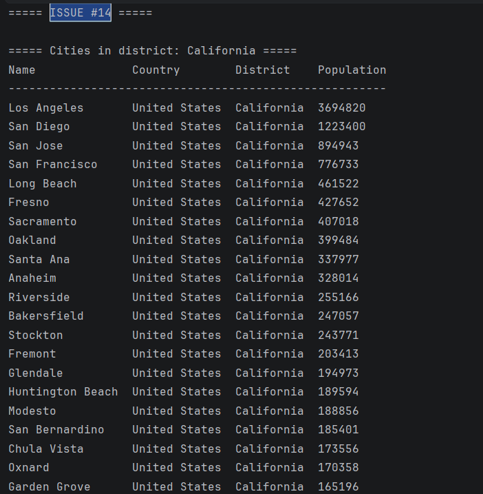](docs/screenshots/issue-14.png) |
| 12 | Top N cities in the world | [#15](https://github.com/kaungmyatlwin18/Group_11-DevOps/issues/15) | [#64](https://github.com/kaungmyatlwin18/Group_11-DevOps/pull/64) | Yes | [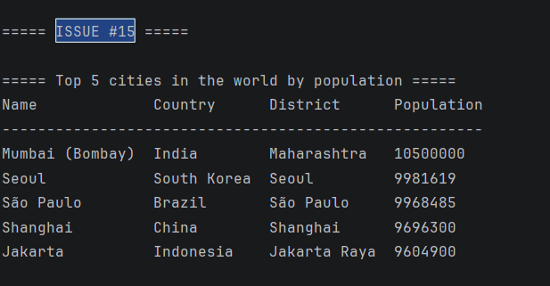](docs/screenshots/issue-15.png) |
| 13 | Top N cities in a continent | [#16](https://github.com/kaungmyatlwin18/Group_11-DevOps/issues/16) | [#65](https://github.com/kaungmyatlwin18/Group_11-DevOps/pull/65) | Yes | [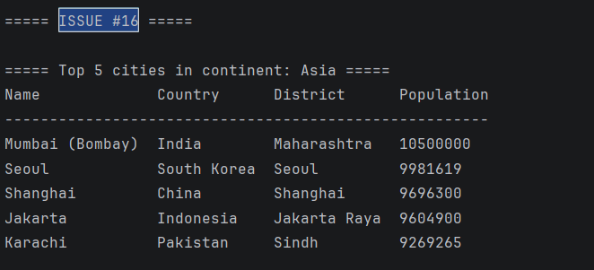](docs/screenshots/issue-16.png) |
| 14 | Top N cities in a region | [#17](https://github.com/kaungmyatlwin18/Group_11-DevOps/issues/17) | [#66](https://github.com/kaungmyatlwin18/Group_11-DevOps/pull/66) | Yes | [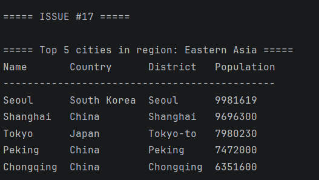](docs/screenshots/issue-17.png) |
| 15 | Top N cities in a country | [#18](https://github.com/kaungmyatlwin18/Group_11-DevOps/issues/18) | [#67](https://github.com/kaungmyatlwin18/Group_11-DevOps/pull/67) | Yes | [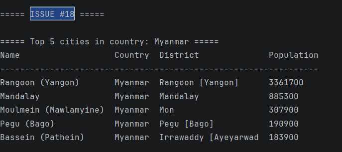](docs/screenshots/issue-18.png) |
| 16 | Top N cities in a district | [#19](https://github.com/kaungmyatlwin18/Group_11-DevOps/issues/19) | [#68](https://github.com/kaungmyatlwin18/Group_11-DevOps/pull/68) | Yes | [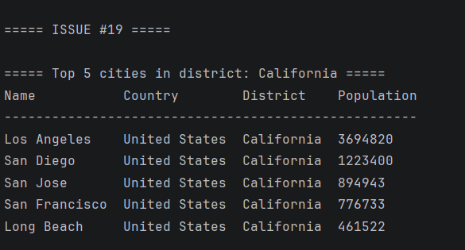](docs/screenshots/issue-19.png) |

### 4.3 Capital City Reports

| ID | Requirement | GitHub Issue | Pull Request | Met? | Output Screenshot |
|---:|---|---|---|---|---|
| 17 | All capital cities in the world by population | [#20](https://github.com/kaungmyatlwin18/Group_11-DevOps/issues/20) | [#69](https://github.com/kaungmyatlwin18/Group_11-DevOps/pull/69) | Yes | [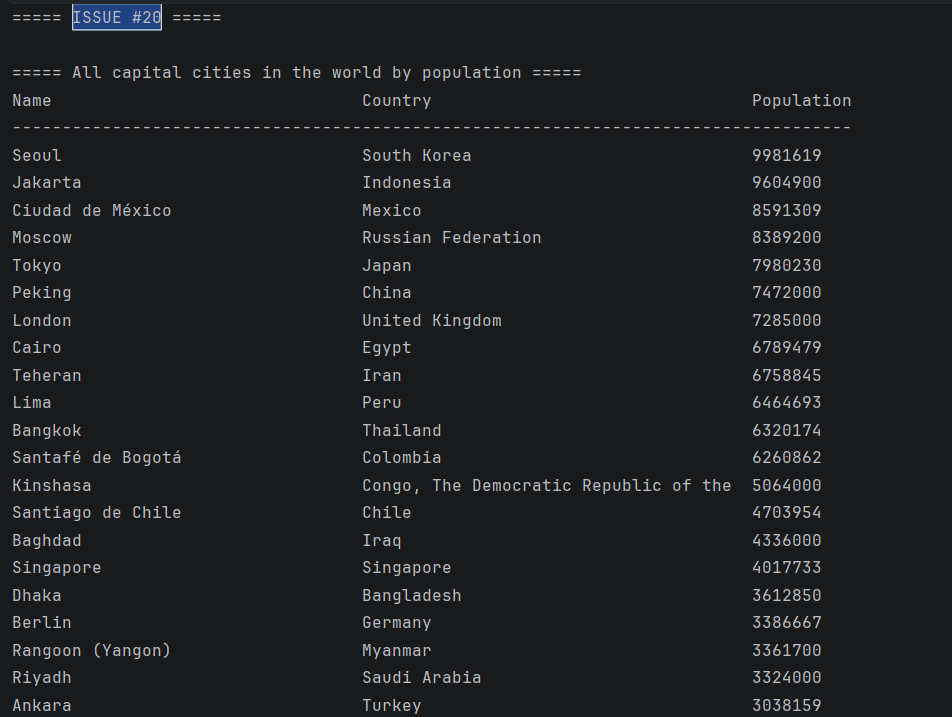](docs/screenshots/issue-20.png) |
| 18 | All capital cities in a continent by population | [#21](https://github.com/kaungmyatlwin18/Group_11-DevOps/issues/21) | [#70](https://github.com/kaungmyatlwin18/Group_11-DevOps/pull/70) | Yes | [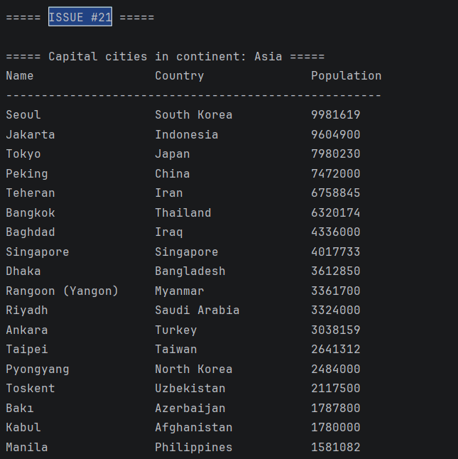](docs/screenshots/issue-21.png) |
| 19 | All capital cities in a region by population | [#22](https://github.com/kaungmyatlwin18/Group_11-DevOps/issues/22) | [#71](https://github.com/kaungmyatlwin18/Group_11-DevOps/pull/71) | Yes | [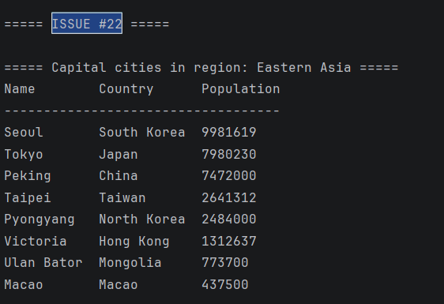](docs/screenshots/issue-22.png) |
| 20 | Top N capital cities in the world | [#23](https://github.com/kaungmyatlwin18/Group_11-DevOps/issues/23) | [#72](https://github.com/kaungmyatlwin18/Group_11-DevOps/pull/72) | Yes | [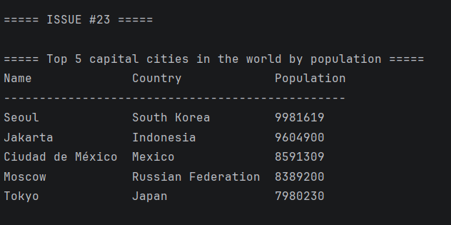](docs/screenshots/issue-23.png) |
| 21 | Top N capital cities in a continent | [#24](https://github.com/kaungmyatlwin18/Group_11-DevOps/issues/24) | [#82](https://github.com/kaungmyatlwin18/Group_11-DevOps/pull/82) | Yes | [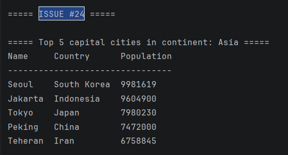](docs/screenshots/issue-24.png) |
| 22 | Top N capital cities in a region | [#25](https://github.com/kaungmyatlwin18/Group_11-DevOps/issues/25) | [#83](https://github.com/kaungmyatlwin18/Group_11-DevOps/pull/83) | Yes | [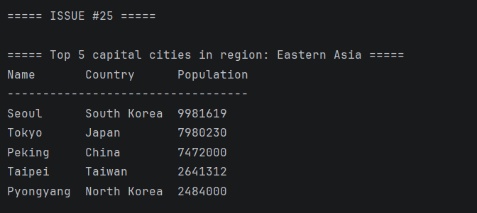](docs/screenshots/issue-25.png) |

### 4.4 Population Distribution Reports

| ID | Requirement | GitHub Issue | Pull Request | Met? | Output Screenshot |
|---:|---|---|---|---|---|
| 23 | Population living and not living in cities for each continent, including percentages | [#26](https://github.com/kaungmyatlwin18/Group_11-DevOps/issues/26) | [#73](https://github.com/kaungmyatlwin18/Group_11-DevOps/pull/73) | Yes | [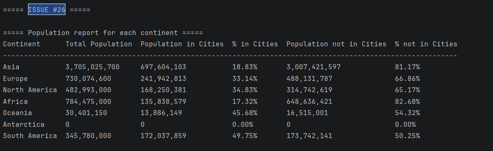](docs/screenshots/issue-26.png) |
| 24 | Population living and not living in cities for each region, including percentages | [#27](https://github.com/kaungmyatlwin18/Group_11-DevOps/issues/27) | [#74](https://github.com/kaungmyatlwin18/Group_11-DevOps/pull/74) | Yes | [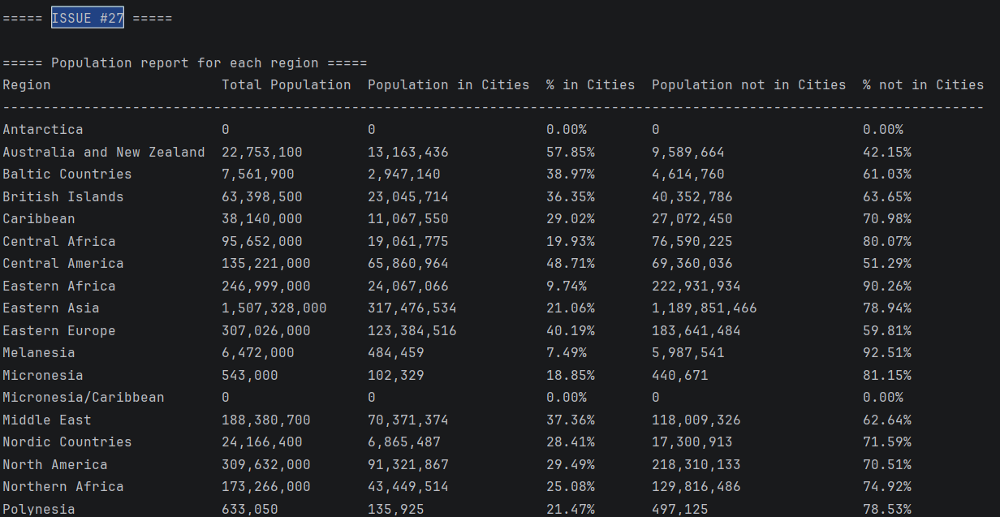](docs/screenshots/issue-27.png) |
| 25 | Population living and not living in cities for each country, including percentages | [#28](https://github.com/kaungmyatlwin18/Group_11-DevOps/issues/28) | [#75](https://github.com/kaungmyatlwin18/Group_11-DevOps/pull/75) | Yes | [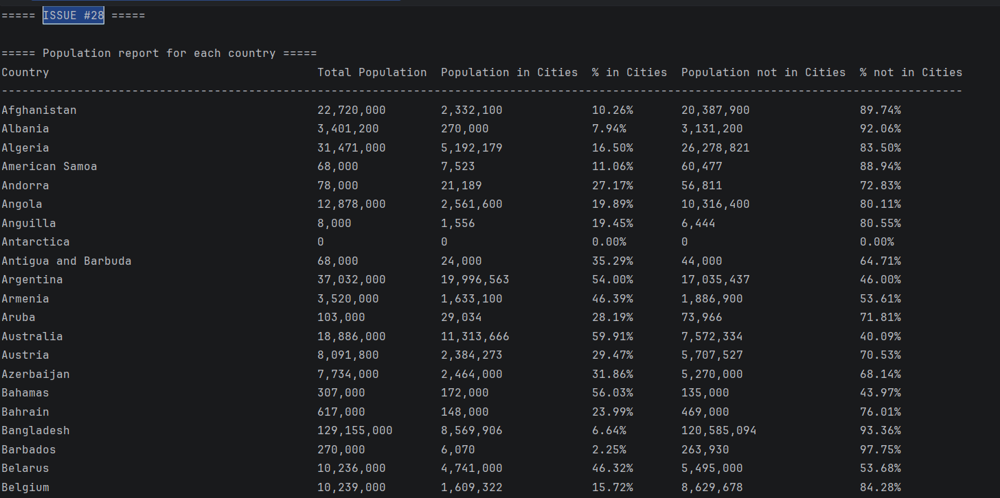](docs/screenshots/issue-28.png) |

### 4.5 Population Information

| ID | Requirement | GitHub Issue | Pull Request | Met? | Output Screenshot |
|---:|---|---|---|---|---|
| 26 | Population of the world | [#29](https://github.com/kaungmyatlwin18/Group_11-DevOps/issues/29) | [#88](https://github.com/kaungmyatlwin18/Group_11-DevOps/pull/88) | Yes | [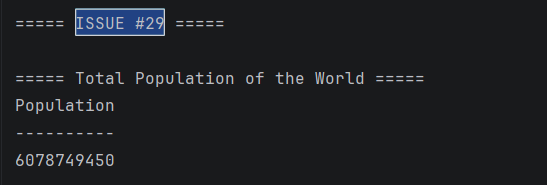](docs/screenshots/issue-29.png) |
| 27 | Population of a selected continent | [#30](https://github.com/kaungmyatlwin18/Group_11-DevOps/issues/30) | [#89](https://github.com/kaungmyatlwin18/Group_11-DevOps/pull/89) | Yes | [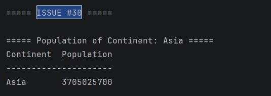](docs/screenshots/issue-30.png) |
| 28 | Population of a selected region | [#31](https://github.com/kaungmyatlwin18/Group_11-DevOps/issues/31) | [#90](https://github.com/kaungmyatlwin18/Group_11-DevOps/pull/90) | Yes | [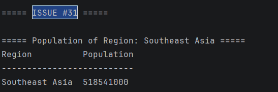](docs/screenshots/issue-31.png) |
| 29 | Population of a selected country | [#32](https://github.com/kaungmyatlwin18/Group_11-DevOps/issues/32) | [#91](https://github.com/kaungmyatlwin18/Group_11-DevOps/pull/91) | Yes | [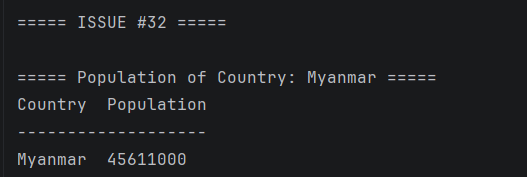](docs/screenshots/issue-32.png) |
| 30 | Population of a selected district | [#33](https://github.com/kaungmyatlwin18/Group_11-DevOps/issues/33) | [#86](https://github.com/kaungmyatlwin18/Group_11-DevOps/pull/86) | Yes | [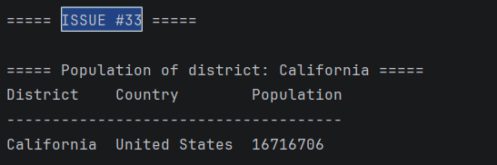](docs/screenshots/issue-33.png) |
| 31 | Population of a selected city | [#34](https://github.com/kaungmyatlwin18/Group_11-DevOps/issues/34) | [#84](https://github.com/kaungmyatlwin18/Group_11-DevOps/pull/84) | Yes | [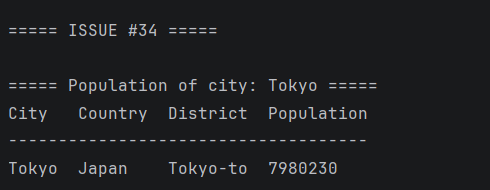](docs/screenshots/issue-34.png) |

### 4.6 Language Statistics

| ID | Requirement | GitHub Issue | Pull Request | Met? | Output Screenshot |
|---:|---|---|---|---|---|
| 32 | Population speaking Chinese, English, Hindi, Spanish and Arabic, including percentages of world population; sorted by number of speakers | [#35](https://github.com/kaungmyatlwin18/Group_11-DevOps/issues/35) | [#85](https://github.com/kaungmyatlwin18/Group_11-DevOps/pull/85) | Yes | [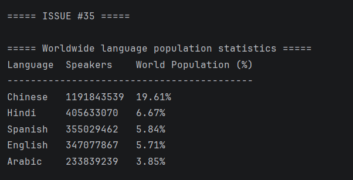](docs/screenshots/issue-35.png) |

## 5. Completed Feature Evidence

The screenshots in Section 4 demonstrate all 32 report outputs. Issues #2, #4 and #6 retain their Code Review 1 screenshots; Issues #7–#35 use the refreshed screenshots supplied for Code Review 2. Full-size evidence is available in [docs/screenshots](docs/screenshots/).

Since Code Review 1, the team has added the city and capital reports, population distribution reports, individual population information and language statistics. Supporting work includes automated unit and integration testing, JaCoCo coverage and a bug reporting system. Changes are traceable through the linked feature PRs.

## 6. Testing and Outcome

Verification snapshot: `64d6faf` on `develop`, 25 November 2026.

| Workflow | Total tests | Passed | Failures | Errors | Skipped | Status |
|---|---:|---:|---:|---:|---:|---|
| Unit and H2-backed tests | 433 | 430 | 0 | 0 | 3 | Passed |
| Full suite with MySQL integration | 433 | 433 | 0 | 0 | 0 | Passed |
| JaCoCo coverage | 433 | 430 | 0 | 0 | 3 | Passed |
| Maven and Docker CI | — | — | — | — | — | Passed |

The three MySQL integration tests are intentionally skipped when database credentials are unset. The separate MySQL integration workflow executes all three successfully. These suites overlap; the test counts must not be added together. The local Maven test run completed with `BUILD SUCCESS` in 7.890 seconds. The final four features added 64 passing tests.

| GitHub Actions evidence | Result |
|---|---|
| [Unit Testing](https://github.com/kaungmyatlwin18/Group_11-DevOps/actions/runs/45585708452) | Success |
| [MySQL Integration Testing](https://github.com/kaungmyatlwin18/Group_11-DevOps/actions/runs/45585707971) | Success |
| [Code Coverage](https://github.com/kaungmyatlwin18/Group_11-DevOps/actions/runs/45585707900) | Success |
| [Maven and Docker CI](https://github.com/kaungmyatlwin18/Group_11-DevOps/actions/runs/45585707758) | Success |

Supporting PRs: [integration testing](https://github.com/kaungmyatlwin18/Group_11-DevOps/pull/61), [unit testing #78](https://github.com/kaungmyatlwin18/Group_11-DevOps/pull/78), [coverage #79](https://github.com/kaungmyatlwin18/Group_11-DevOps/pull/79) and [coverage action maintenance #87](https://github.com/kaungmyatlwin18/Group_11-DevOps/pull/87).

Run unit and H2-backed tests from the repository root in Windows PowerShell:

```powershell
Remove-Item Env:DB_PASSWORD -ErrorAction SilentlyContinue
mvn -B clean test
```

The Maven/Docker CI workflow verifies application build and execution with Docker Compose. The JaCoCo workflow's action versions were upgraded through PR #87; this does not claim that deprecation warnings in other workflows were removed.

## 7. Conclusion

All 32 functional requirements are implemented and merged into `develop`. All four CI workflows passed at the verified snapshot. The test suite has zero failures and zero errors; the full integration run passed all 433 tests. The final coverage figures and screenshots are recorded below. The final release and Code Review 2 contribution agreement remain separate activities.

## 8. Individual Contribution Percentages

| Matric | Code Review 1 | Code Review 2 |
|---|---:|---:|
| 40841053 | 17% | Pending agreement |
| 40841054 | 17% | Pending agreement |
| 40841060 | 17% | Pending agreement |
| 40841062 | 17% | Pending agreement |
| 40841068 | 15% | Pending agreement |
| 40840490 | 17% | Pending agreement |
| **Total** | **100%** | **Pending agreement** |

Code Review 1 percentages are retained. Code Review 2 percentages must be agreed by the team and total 100% before final submission.

## 9. Automated Test Coverage (JaCoCo)

Final development snapshot: `64d6faf`, 25 November 2026. JaCoCo measures production code exercised by unit and H2-backed tests.

| Metric | Covered | Total | Coverage |
|---|---:|---:|---:|
| Instruction | 5,411 | 5,632 | 96.08% |
| Line | 1,133 | 1,191 | 95.13% |
| Branch | 420 | 510 | 82.35% |

Line and branch counts match the successful GitHub coverage run. Instruction counts come from the local report. The HTML report displays rounded percentages. No application-class exclusions or minimum coverage threshold are configured. Untested branches remain, particularly in the core application and population report packages.

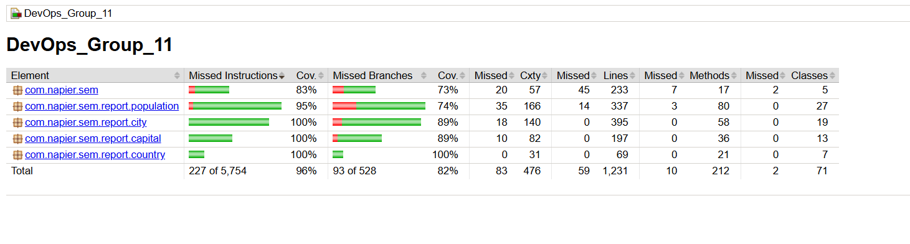

### Generate the report locally (Windows PowerShell)

```powershell
Remove-Item Env:DB_PASSWORD -ErrorAction SilentlyContinue
mvn -B clean verify
Start-Process (Resolve-Path "target/site/jacoco/index.html")
```

The full report is generated under `target/site/jacoco/`, including `index.html`, `jacoco.xml` and `jacoco.csv`. Generated build output is not committed to Git. Download the `group11-jacoco-coverage` artifact from the [successful coverage run](https://github.com/kaungmyatlwin18/Group_11-DevOps/actions/runs/45585707900), extract it and open `index.html`. Use missed lines and branches to guide future tests. Coverage does not replace MySQL integration or Docker verification.

## 10. GitHub Bug Reporting System

The bug reporting template and resolution documentation were added through [Issue #80](https://github.com/kaungmyatlwin18/Group_11-DevOps/issues/80) and [PR #81](https://github.com/kaungmyatlwin18/Group_11-DevOps/pull/81).

- [Bug report template](.github/ISSUE_TEMPLATE/bug_report.md): description, reproduction steps, expected and actual behaviour, environment, severity and evidence.
- [Bug reporting process](docs/bug-reporting.md): prioritisation, assignment, fix branch, regression testing, PR review and closure.

Severity levels are Critical, High, Medium and Low. Only genuine defects should be recorded as ordinary bugs; controlled fault-injection exercises must be explicitly labelled as demonstrations. The documented process uses `fix/issue-N-short-description` branches and reviewed pull requests targeting `develop`.

### 10.1 Error and Bug Register

The [Error and Bug Register](docs/error-and-bug-log.md) records four historical development/CI errors and one controlled application-logic defect demonstration. It contains the observed symptoms, corrective or recovery actions, verification results, evidence limitations and 25 supporting screenshots.

| ID | Error or bug | Outcome |
|---|---|---|
| ERROR-01 | Docker Hub HTTP 429 rate limit | CI recovered after changing base-image registry |
| ERROR-02 | Docker Hub HTTP 504 gateway timeout | CI recovered after changing base-image registry |
| ERROR-03 | JaCoCo plugin resolution failure | Same workflow rerun successfully; underlying cause unconfirmed |
| ERROR-04 | Java compilation failure | Later successful build verified; original fix unconfirmed |
| BUG-01 | Top N capital cities in a region returns one fewer result | Controlled defect reproduced locally; regression test merged |

### 10.2 Controlled Bug Reporting and Resolution Demonstration

On 26 November 2026, the team demonstrated the bug reporting workflow using an intentionally introduced off-by-one error on an isolated local branch. The original shared implementation was correct, and the defective code was not committed or merged. The controlled exercise is recorded separately from genuine historical errors.

- **Bug report:** [Issue #94](https://github.com/kaungmyatlwin18/Group_11-DevOps/issues/94), related to [Issue #25](https://github.com/kaungmyatlwin18/Group_11-DevOps/issues/25).
- **Developer:** Htoo Aung Lin; **Scrum Master reviewer:** Kaung Myat Lwin.
- **Reviewed PR:** [PR #95](https://github.com/kaungmyatlwin18/Group_11-DevOps/pull/95), merged into `develop` at [`3092ca3`](https://github.com/kaungmyatlwin18/Group_11-DevOps/commit/3092ca3e3a41803dbf16c3aca8eb532106149bee).
- **Result:** All 20 related tests passed; the post-merge MySQL integration workflow passed all 434 tests with zero failures, errors or skips. All four post-merge CI workflows passed.

| Bug detection | Formal review |
|---|---|
| [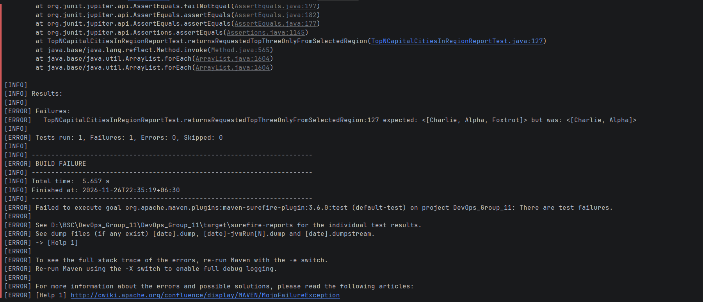](docs/bug-evidence/bug-01-junit-test-failure.png) | [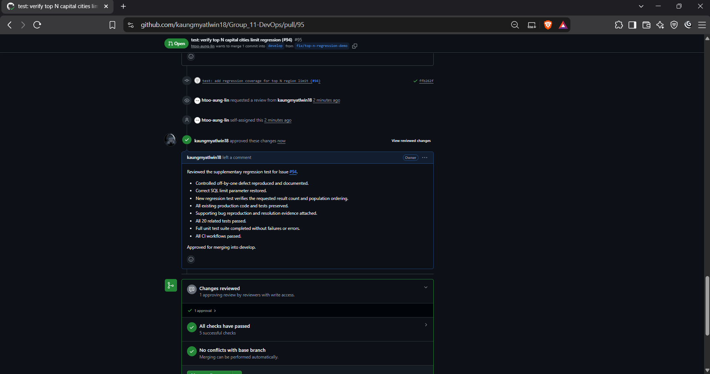](docs/bug-evidence/bug-01-pr-approval.png) |

See the [complete resolution evidence and test results](docs/error-and-bug-log.md#4-bug-01--top-n-capital-cities-report-returns-one-fewer-result) and [evidence directory](docs/bug-evidence/). This later verification is separate from the Code Review 2 snapshot dated 25 November 2026.
