# Group 11 — Error and Bug Register

**Module:** SET09803 DevOps<br>
**Project:** Population Reporting System<br>
**Evidence review:** 27 November 2026<br>
**Verified application baseline:** `develop` at `3092ca3`

## 1. Purpose and scope

This register records four historical development or CI errors, one controlled application-logic defect demonstration and one genuine historical CI/CD configuration defect. It distinguishes observed symptoms, confirmed corrective actions, recovery evidence and unresolved historical root causes. BUG-01 is a deliberately introduced local defect for demonstrating the bug reporting process, not a defect discovered in the shared production implementation. BUG-02 is a historical workflow configuration defect corrected during unit testing setup.

The [bug reporting process](bug-reporting.md) and [GitHub issue template](../.github/ISSUE_TEMPLATE/bug_report.md) define the team's normal reporting and resolution workflow. Screenshots are stored in [bug-evidence/](bug-evidence/).

## 2. Error and bug summary

| ID | Description | Category | Resolution status |
|---|---|---|---|
| ERROR-01 | Docker Hub HTTP 429 rate limit | External registry / CI | Recovered after switching image registry |
| ERROR-02 | Docker Hub HTTP 504 gateway timeout | External registry / CI | Recovered after switching image registry |
| ERROR-03 | JaCoCo Maven plugin resolution failure | Dependency resolution | Successful rerun; underlying cause not established |
| ERROR-04 | Java compilation failure in `CountryReport.java` | Compilation / syntax | Current build verified; original corrective change not established |
| BUG-01 | Top N region report returns one fewer capital than requested | Application logic — controlled exercise | Local defect corrected; additional regression test reviewed and merged |
| BUG-02 | Incorrect unit testing workflow branch trigger | CI/CD configuration — historical defect | Branch filter corrected and merged; PR workflow passed |

## 3. Historical errors

### ERROR-01 — Docker Hub HTTP 429 rate limit

**Observed:** 10 October 2026 (Myanmar local time).

- **Symptom:** Maven completed, but the Docker build failed while retrieving base-image metadata for `eclipse-temurin:25` and `mysql:8.4`. The registry returned HTTP 429.
- **Cause:** Docker Hub rate limiting was indicated by the registry response; the precise account or quota conditions were not established.
- **Initial action:** Docker Hub authentication was added to GitHub Actions using repository secrets. This did not establish a reliable recovery because a subsequent attempt encountered HTTP 504 (ERROR-02).
- **Corrective action:** The base-image references were changed to `public.ecr.aws/docker/library/eclipse-temurin:25` and `public.ecr.aws/docker/library/mysql:8.4`, avoiding the Docker Hub retrieval path. The Docker Hub login step was removed.
- **Verification:** CI run #41 succeeded at the ECR configuration commit. This verifies recovery, not a change to Docker Hub's own quota policy.

**Evidence:** [Original failed CI job](https://github.com/kaungmyatlwin18/Group_11-DevOps/actions/runs/37990760004/job/114026641101) · [Authentication attempt commit](https://github.com/kaungmyatlwin18/Group_11-DevOps/commit/6854abd2e724004a7f19258bf148a0899dade139) · [ECR configuration commit](https://github.com/kaungmyatlwin18/Group_11-DevOps/commit/0dfd6a7d07daf31288966523eeffa4fb746c68f9) · [Successful CI run](https://github.com/kaungmyatlwin18/Group_11-DevOps/actions/runs/37996660024)

| Before | Authentication attempt |
|---|---|
| [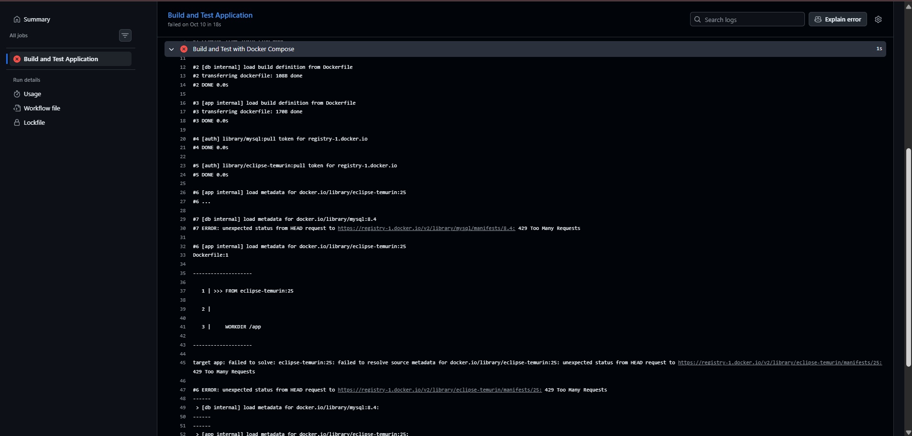](bug-evidence/error-01-docker-rate-limit-before.png) | [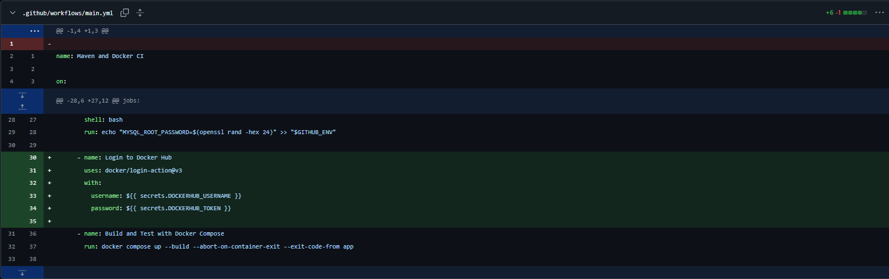](bug-evidence/docker-authentication-fix-attempt.png) |

### ERROR-02 — Docker Hub HTTP 504 gateway timeout

**Observed:** 10 October 2026 (Myanmar local time).

- **Symptom:** Docker image retrieval failed with HTTP 504 at the Docker Hub authentication/token endpoint, even though the login step succeeded.
- **Cause:** The response indicates a gateway timeout in the external registry access path. The precise upstream service failure was not established.
- **Corrective action:** The same ECR public-registry configuration change described in ERROR-01 bypassed the problematic Docker Hub path.
- **Verification:** The subsequent CI run #41 completed successfully. The exact failed workflow run corresponding to the screenshot has not been conclusively matched, so no specific failed-run URL is asserted here.

**Evidence:** [ECR configuration commit](https://github.com/kaungmyatlwin18/Group_11-DevOps/commit/0dfd6a7d07daf31288966523eeffa4fb746c68f9) · [Successful CI run](https://github.com/kaungmyatlwin18/Group_11-DevOps/actions/runs/37996660024)

[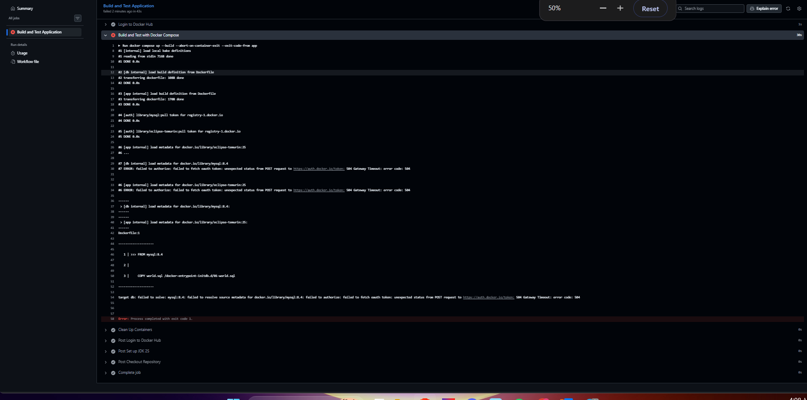](bug-evidence/error-02-docker-gateway-timeout-before.png)

**Shared recovery evidence for ERROR-01 and ERROR-02:**

| Registry configuration change | Successful CI after change |
|---|---|
| [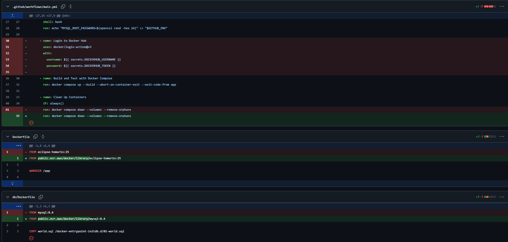](bug-evidence/docker-ecr-public-fix.png) | [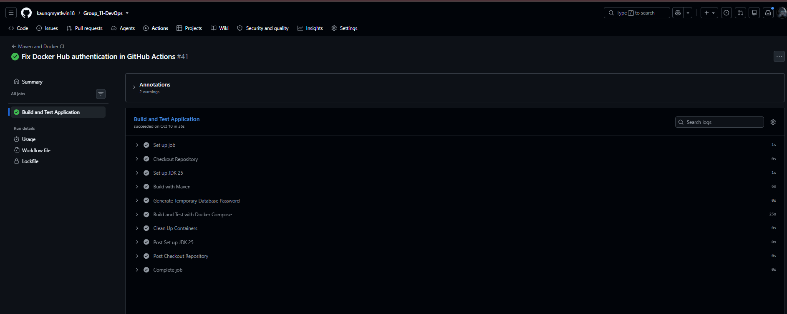](bug-evidence/docker-ci-recovery-after.png) |

### ERROR-03 — JaCoCo Maven plugin resolution failure

**Observed:** 20 November 2026 (Myanmar local time; 19 November UTC).

- **Symptom:** Maven reported a `PluginResolutionException` when attempting to resolve `org.jacoco:jacoco-maven-plugin:0.8.16` from Maven Central. The coverage workflow failed.
- **Cause:** Plugin resolution failed during that attempt. The exact underlying reason is not established by the available evidence.
- **Recovery action:** The same workflow was rerun. The successful attempt used the same commit (`929b7f4`) and JaCoCo version (`0.8.16`); no plugin version change is claimed.
- **Verification:** The rerun completed successfully and generated and uploaded coverage reports.

**Evidence:** [Failed attempt](https://github.com/kaungmyatlwin18/Group_11-DevOps/actions/runs/44579784777/job/135756984893) · [Successful rerun](https://github.com/kaungmyatlwin18/Group_11-DevOps/actions/runs/44579784777/job/135757983770)

| Failed plugin resolution | Successful rerun |
|---|---|
| [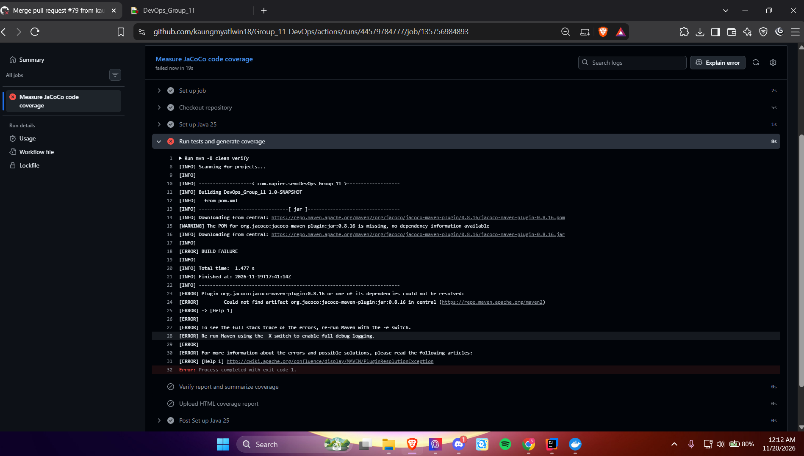](bug-evidence/error-03-jacoco-plugin-resolution-before.png) | [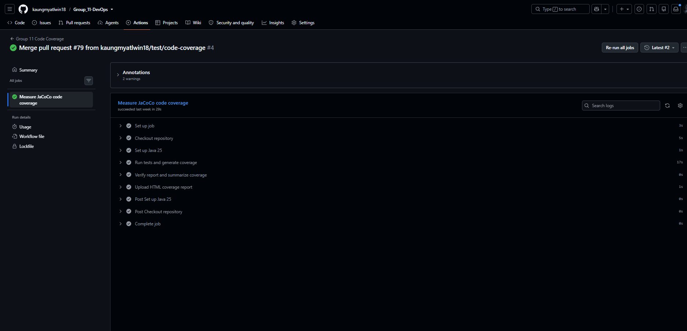](bug-evidence/error-03-jacoco-plugin-resolution-after.png) |

### ERROR-04 — Java compilation failure

**Observed:** 9 October 2026 (Myanmar local time).

- **Symptom:** `mvn clean test` failed to compile `CountryReport.java`. Maven reported `')' expected` and `';' expected` at lines 56 and 82.
- **Cause:** The compiler diagnostics indicate a Java syntax problem. The precise original source mistake and historical correction were not established from the retained evidence.
- **Verification:** A later `mvn -B clean package` run on 26 November 2026 at `4974fc8` succeeded with 433 tests: 430 passed, zero failures, zero errors and three skipped integration tests.
- **Limitation:** This successful build confirms the current compilation state at that baseline. It is not a contemporaneous screenshot of the original fix, and no particular historical fix commit is claimed.

| Historical compilation failure | Later successful build |
|---|---|
| [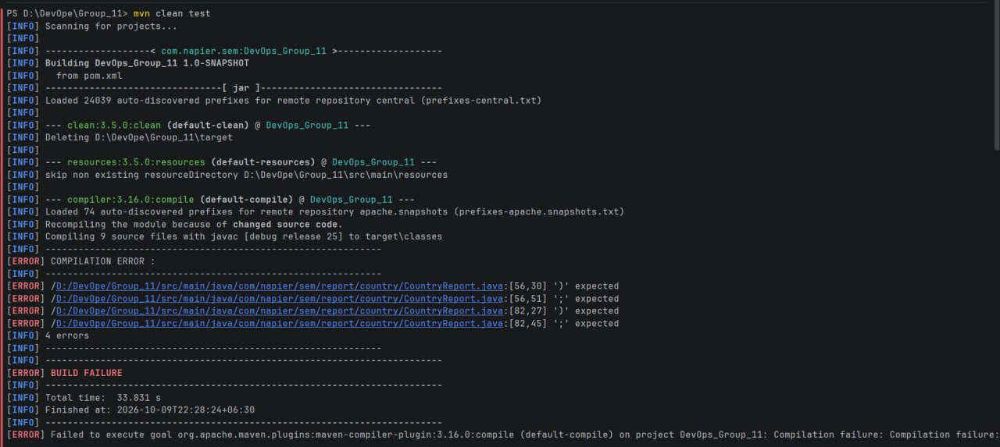](bug-evidence/error-04-java-compilation-before.png) | [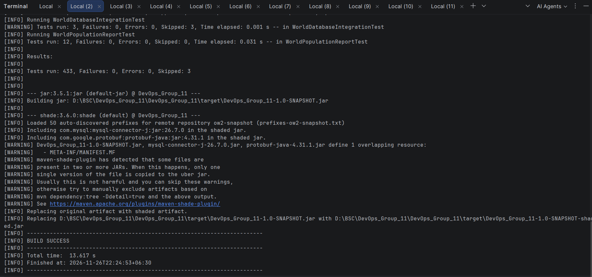](bug-evidence/error-04-java-compilation-current-verification.png) |

## 4. BUG-01 — Top N capital cities report returns one fewer result

**Demonstration date:** 26 November 2026.<br>
**Severity:** Medium (exercise classification).<br>
**Related requirement:** [Issue #25](https://github.com/kaungmyatlwin18/Group_11-DevOps/issues/25).<br>
**Bug report:** [Issue #94](https://github.com/kaungmyatlwin18/Group_11-DevOps/issues/94).<br>
**Developer:** Htoo Aung Lin (`htoo-aung-lin`).<br>
**Scrum Master / reviewer:** Kaung Myat Lwin (`kaungmyatlwin18`).<br>
**Status:** Regression-test PR merged into `develop`; issue closed as completed.

### 4.1 Reproduction and diagnosis

The Scrum Master first verified the original implementation using the existing H2/JUnit test. On an isolated local branch (`fix/top-n-regression-demo`), the SQL limit parameter in `TopNCapitalCitiesInRegionQuery.java` was intentionally changed from the correct value `n` to `n - 1`.

```java
// Intentional local fault
statement.setInt(2, n - 1);
```

Reproduction command:

```powershell
mvn -B "-Dtest=TopNCapitalCitiesInRegionReportTest#returnsRequestedTopThreeOnlyFromSelectedRegion" test
```

| Condition | Expected | Actual with local fault |
|---|---|---|
| Region | Eastern Asia | Eastern Asia |
| Requested N | 3 | 3 |
| Results | Charlie, Alpha, Foxtrot | Charlie, Alpha |
| JUnit result | Pass | One assertion failure |

The off-by-one error reduced the SQL `LIMIT` by one. The original passing test failed after the controlled mutation, demonstrating that the existing automated test detects the defect. The Scrum Master recorded the result in Issue #94 using the team's bug report template.

| Original passing test | Intentionally defective code |
|---|---|
| [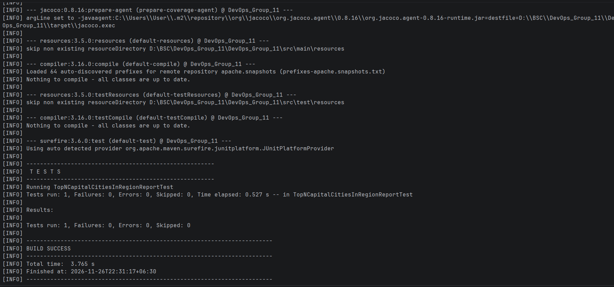](bug-evidence/bug-01-original-test-success.png) | [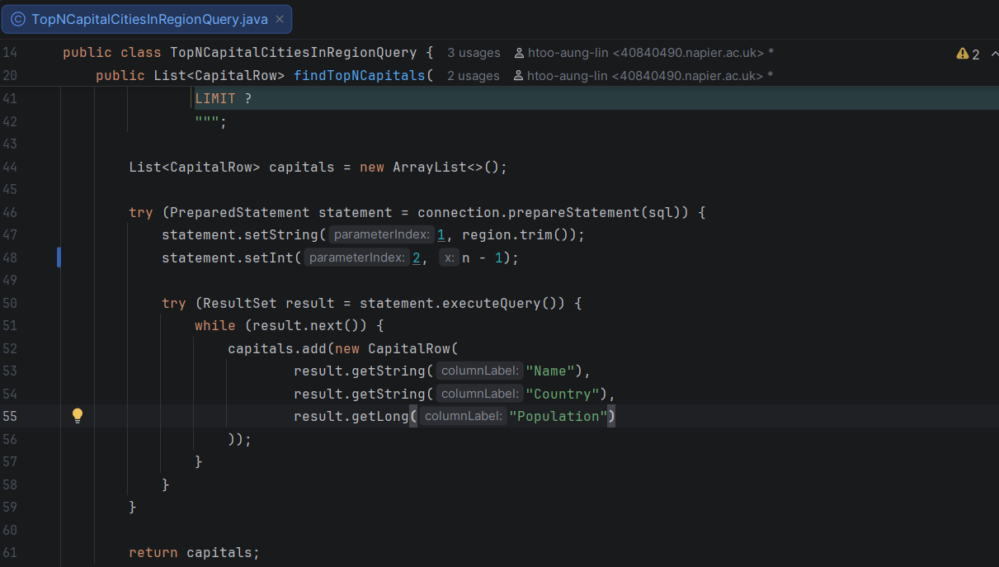](bug-evidence/bug-01-defective-code.png) |

| JUnit detects defect | GitHub bug report |
|---|---|
| [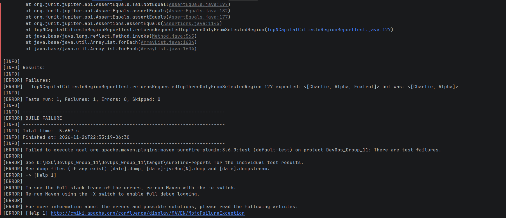](bug-evidence/bug-01-junit-test-failure.png) | [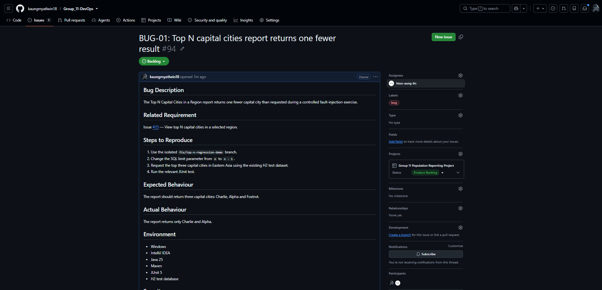](bug-evidence/bug-01-github-issue.png) |

### 4.2 Developer reproduction and correction

Developer 1 reproduced the controlled fault on his local branch and supplied before-and-after evidence in PR #95. The correct implementation was restored:

```java
statement.setInt(2, n);
```

The shared `develop` and `master` branches did not receive the intentionally defective source. Because the correction restored the original implementation, the final PR contains no production-code changes.

| Developer baseline | Developer local fault |
|---|---|
| [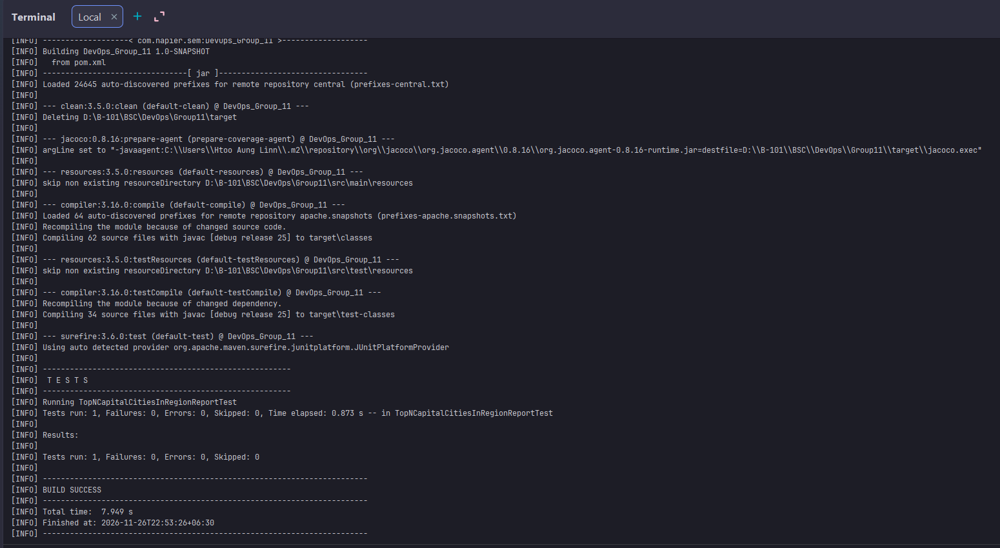](bug-evidence/bug-01-dev1-baseline-success.png) | [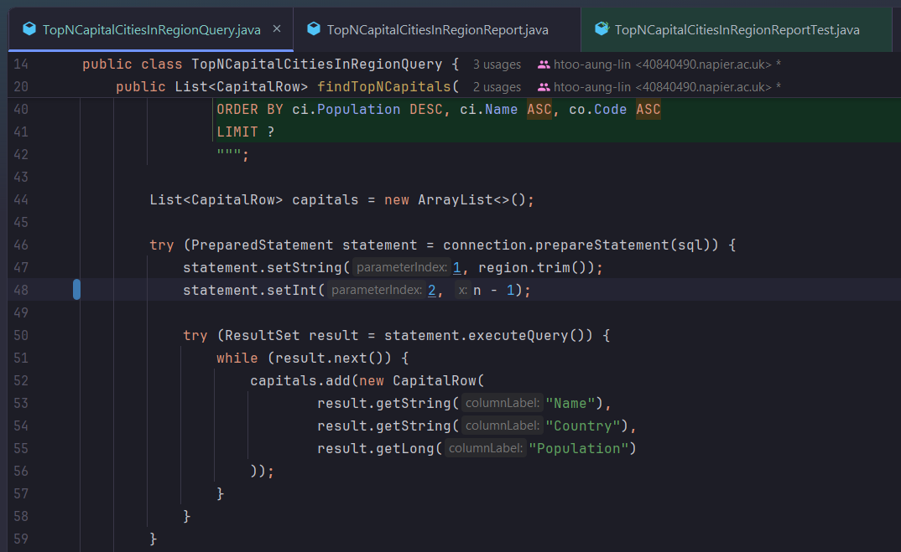](bug-evidence/bug-01-dev1-reproduced-code.png) |

| Developer failed test | Corrected code |
|---|---|
| [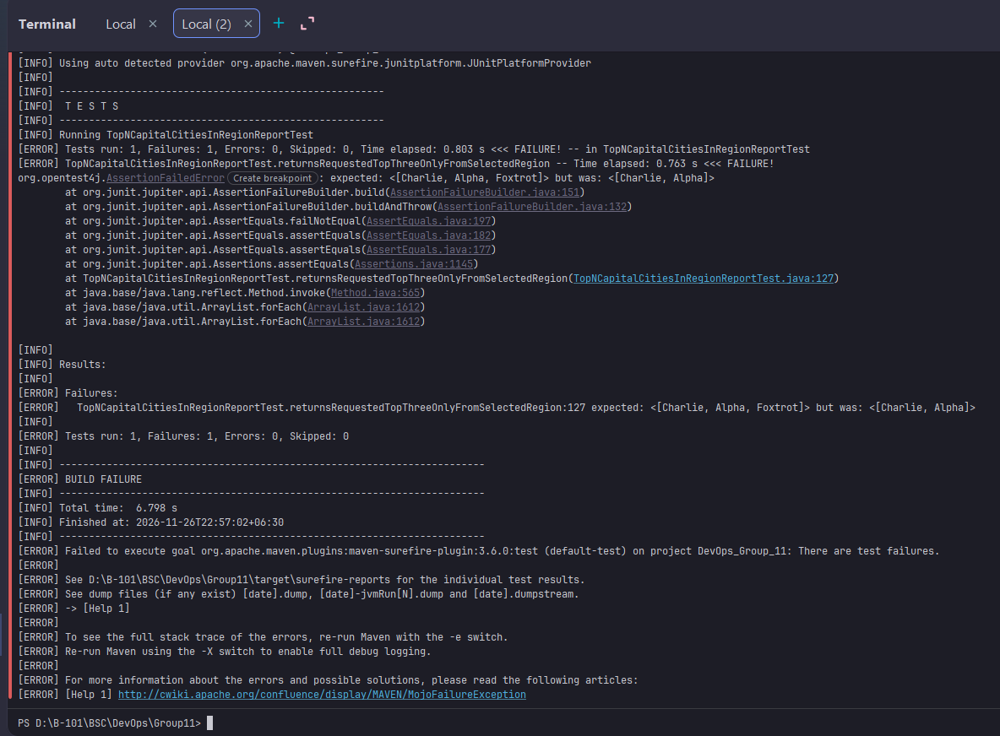](bug-evidence/bug-01-dev1-test-failure.png) | [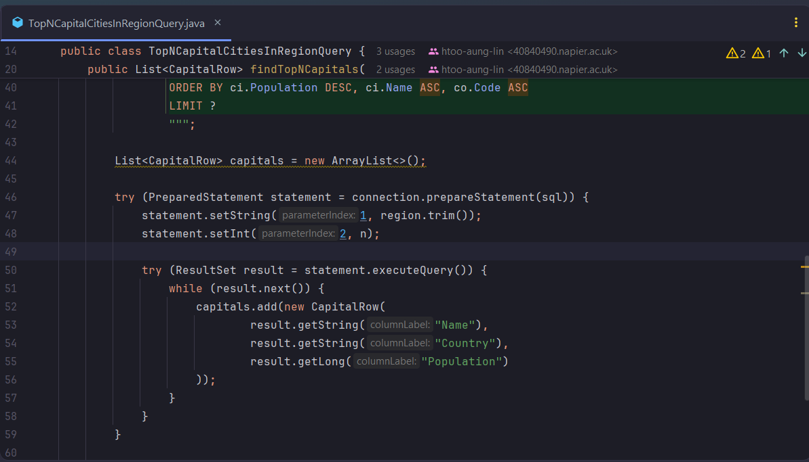](bug-evidence/bug-01-fixed-code.png) |

[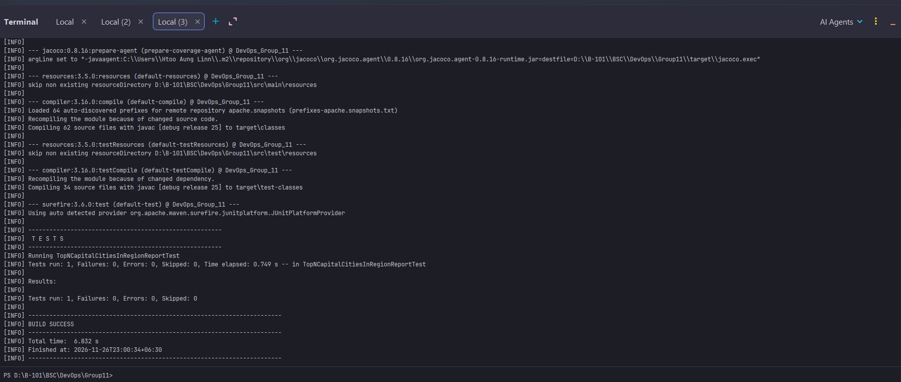](bug-evidence/bug-01-junit-test-success.png)

The replacement screenshot shows a successful single-test run of the related test class at 23:00:34 on 26 November 2026. The exact method and its position relative to the local correction are not visible in that screenshot; successful PR and post-merge CI independently verify the corrected behaviour.

### 4.3 Supplementary regression test

Developer 1 added `returnsExactlyTwoCapitalsWhenTwoAreRequested()` to `src/test/java/TopNCapitalCitiesInRegionReportTest.java`. It checks that the query returns exactly two capital rows and that their names are `Charlie`, then `Alpha`, in the expected population order for the fixture. The existing tests and production implementation were preserved.

- **Commit:** [`ffb262f`](https://github.com/kaungmyatlwin18/Group_11-DevOps/commit/ffb262ffa9cd4592fad44b293d93d40d4d5009d3)
- **Commit message:** `test: add regression coverage for top N region limit (#94)`
- **Diff:** One test file changed; 17 insertions, zero deletions.

| Regression suite evidence | Full local build evidence |
|---|---|
| [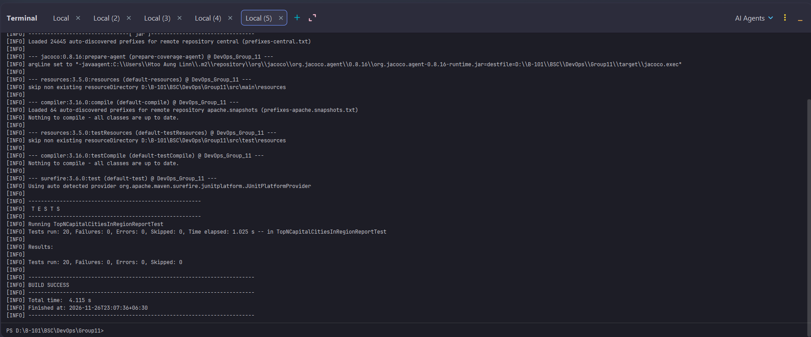](bug-evidence/bug-01-regression-test-success.png) | [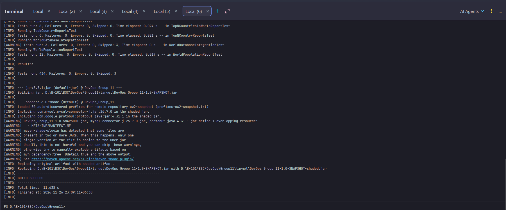](bug-evidence/bug-01-full-build-success.png) |

### 4.4 Review, CI and closure

[PR #95](https://github.com/kaungmyatlwin18/Group_11-DevOps/pull/95) was opened by Developer 1, formally approved by the Scrum Master and merged into `develop` on 26 November 2026. All five displayed GitHub checks passed; the four named CI workflows were independently verified as successful. Issue #94 was closed as completed through the linked PR.

| Scrum Master formal approval | Successful PR checks |
|---|---|
| [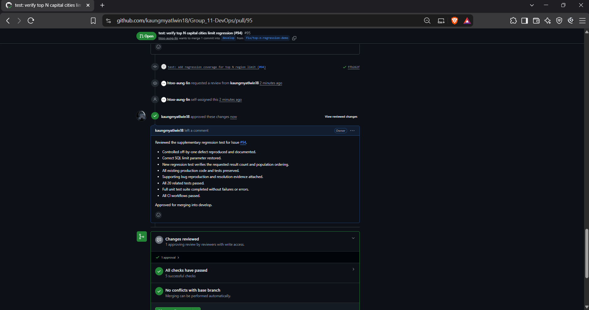](bug-evidence/bug-01-pr-approval.png) | [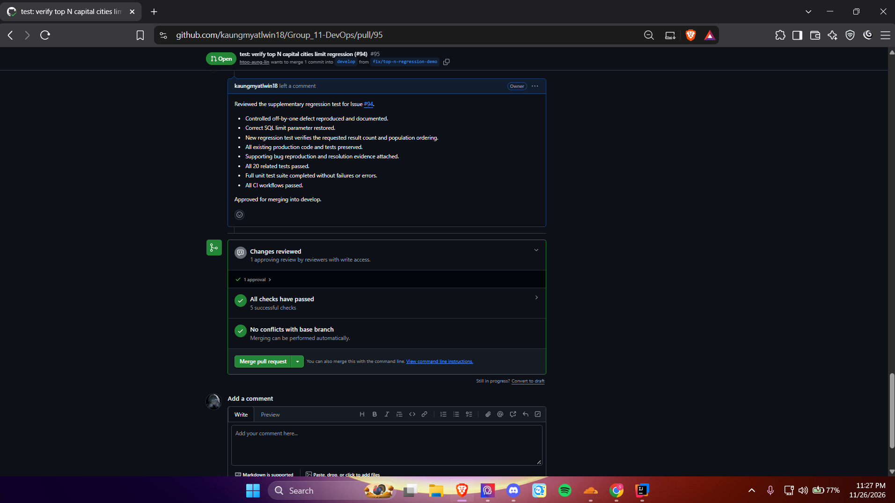](bug-evidence/bug-01-ci-success.png) |

| Merged PR | Closed issue |
|---|---|
| [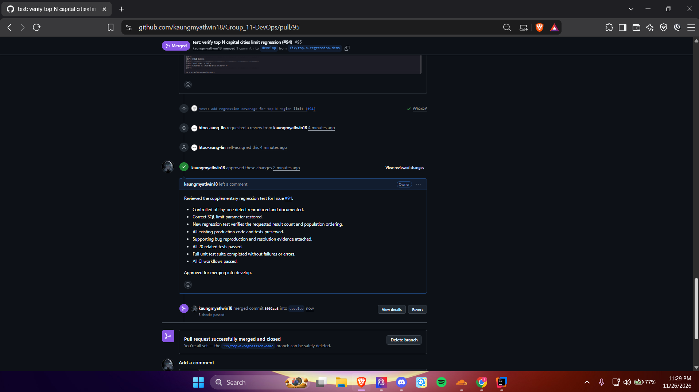](bug-evidence/bug-01-pr-merged.png) | [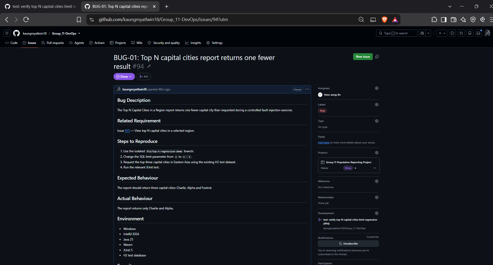](bug-evidence/bug-01-closed-issue.png) |

**Merge commit:** [`3092ca3`](https://github.com/kaungmyatlwin18/Group_11-DevOps/commit/3092ca3e3a41803dbf16c3aca8eb532106149bee)

| Post-merge workflow | Result |
|---|---|
| [Maven and Docker CI](https://github.com/kaungmyatlwin18/Group_11-DevOps/actions/runs/45863733752) | Passed |
| [Unit Testing](https://github.com/kaungmyatlwin18/Group_11-DevOps/actions/runs/45863733714) | Passed |
| [Code Coverage](https://github.com/kaungmyatlwin18/Group_11-DevOps/actions/runs/45863733712) | Passed |
| [Integration Testing](https://github.com/kaungmyatlwin18/Group_11-DevOps/actions/runs/45863733850) | Passed |

[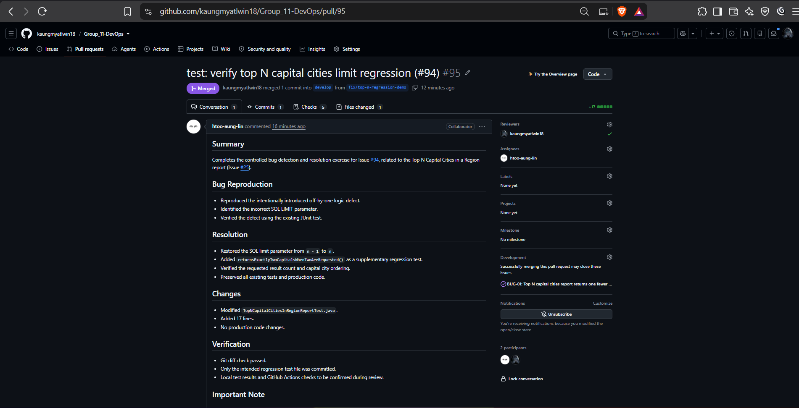](bug-evidence/bug-01-post-merge-ci.png)

### 4.5 Verified test outcomes

| Test scope | Total | Passed | Failures | Errors | Skipped |
|---|---:|---:|---:|---:|---:|
| Issue #25 test class (PR CI) | 20 | 20 | 0 | 0 | 0 |
| PR unit testing / coverage workflows | 434 | 431 | 0 | 0 | 3 |
| Post-merge MySQL integration workflow | 434 | 434 | 0 | 0 | 0 |

The three skipped integration tests in the unit-only environment ran successfully in the MySQL integration workflow. The regression test increased the project test count from 433 to 434. These results are tied to the stated workflow runs, not a replacement for the earlier Code Review 2 evidence snapshot in the README.

## 5. BUG-02 — Incorrect unit testing workflow branch trigger

**Correction date:** 19 November 2026.<br>
**Category:** CI/CD configuration defect (genuine historical defect).<br>
**Related issue:** [Issue #76 — Unit Testing](https://github.com/kaungmyatlwin18/Group_11-DevOps/issues/76).<br>
**Affected file:** `.github/workflows/unit-tests.yml`.<br>
**Correction author:** Kaung Myat Lwin (`kaungmyatlwin18`).<br>
**Status:** Corrected and merged into `develop` through PR #78.

### 5.1 Diagnosis

The original independent unit testing workflow configured a push branch filter that did not match the actual working branch, `test/unit-testing`. As a result, a push to that working branch would not satisfy the workflow's push filter. The separate `pull_request` trigger targeting `develop` and manual dispatch were unaffected. This diagnosis is based on the historical configuration diff, rather than a captured failed test or a failed push-triggered run.

**Original configuration:**

```yaml
on:
  push:
    branches:
      - develop
      - test/issue-76-unit-tests
```

[Original workflow commit `3222f4e`](https://github.com/kaungmyatlwin18/Group_11-DevOps/commit/3222f4effcda7787e26e46366b133629199decd0)

### 5.2 Corrective action

The Scrum Master corrected the branch filter to match the actual working branch. No application source changes were needed for this correction.

```yaml
on:
  push:
    branches:
      - develop
      - test/unit-testing
```

**Correction commit:** [`0788b20`](https://github.com/kaungmyatlwin18/Group_11-DevOps/commit/0788b2004ee69dab9611815bcf52f47bda5fdf38) — `fix(ci): correct unit testing branch trigger (#76)`.

| Original incorrect configuration | Corrected configuration |
|---|---|
| [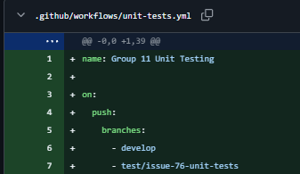](bug-evidence/bug-02-incorrect-trigger.png) | [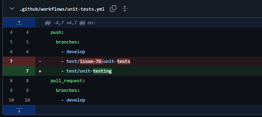](bug-evidence/bug-02-trigger-fix.png) |

### 5.3 Verification and merge

The [independent unit testing workflow run](https://github.com/kaungmyatlwin18/Group_11-DevOps/actions/runs/44499559920) succeeded on correction commit `0788b20`, with head branch `test/unit-testing` and event `pull_request`. The [actual job log](https://github.com/kaungmyatlwin18/Group_11-DevOps/actions/runs/44499559920/job/135475414567) confirms the following results:

| Metric | Result |
|---|---:|
| Total tests | 283 |
| Passed | 280 |
| Failures | 0 |
| Errors | 0 |
| Skipped MySQL integration tests | 3 |
| Maven build | SUCCESS |

The correction was included in [PR #78](https://github.com/kaungmyatlwin18/Group_11-DevOps/pull/78), merged into `develop` at [`d788801`](https://github.com/kaungmyatlwin18/Group_11-DevOps/commit/d7888011d0d40842f28bc28fd56641ec18ffd481). The PR records the branch-trigger correction as part of Issue #76. No separate historical bug issue or additional developer fix is claimed.

| Successful PR workflow | Merged pull request |
|---|---|
| [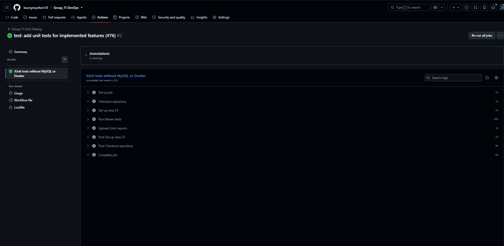](bug-evidence/bug-02-ci-success.png) | [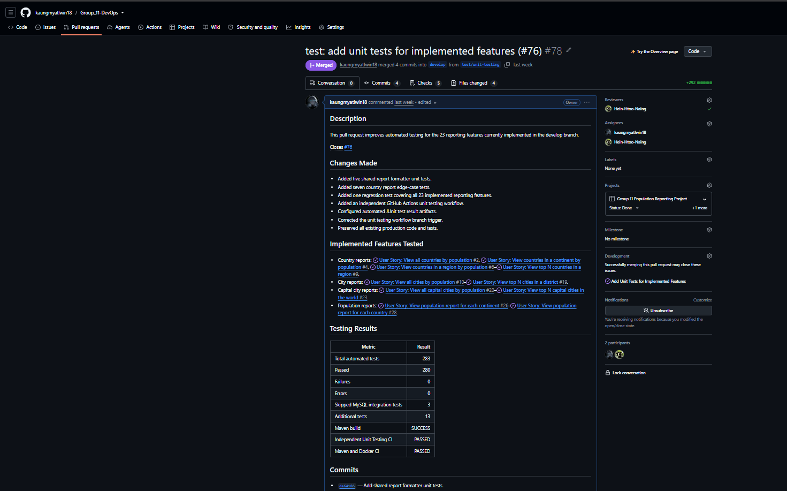](bug-evidence/bug-02-pr-merged.png) |

**Evidence limitation:** The successful workflow confirms that automated tests ran on the corrected commit through the PR trigger. It is not direct evidence that the corrected push trigger fired. No failed CI run is claimed for this configuration mismatch. The 283-test result is historical and does not replace the later 434-test verification in BUG-01.

## 6. Lessons learned and preventive actions

| Area | Recommended preventive action |
|---|---|
| Registry access | Monitor external registry availability and rate limits; document and review approved base-image sources. |
| Dependency resolution | Record dependency versions and workflow logs; investigate repeat resolution failures rather than treating every successful retry as a permanent fix. |
| Compilation | Run Maven compilation and tests before pushing; retain the exact failing diff and corrective commit when possible. |
| Application logic | Test result boundaries, including N = 1, N = 2, N = 3 and N greater than the available records. |
| CI/CD configuration | Cross-check workflow branch filters against actual working branches and verify each intended event type independently. |
| Team process | Use issue reporting, isolated branches, reviewed PRs, automated CI and closure evidence; distinguish demonstrations from historical production defects. |

**Evidence inventory:** 29 PNG files (9 historical error screenshots, 9 BUG-01 Scrum Master screenshots, 7 BUG-01 Developer 1 screenshots and 4 BUG-02 screenshots). Historical source limitations are explicitly recorded above.
