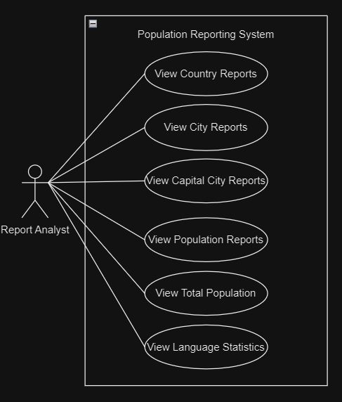

# Group 11 – Sprint 1 Use Cases

**Project:** Population Reporting System  
**Module:** SET09803 – DevOps  
**Scope:** Six Country Report requirements assigned to Sprint 1

These six documents describe the six individual Country Report features currently called from the Group 11 Java application. Each document follows the agreed use-case format: characteristic information, main success scenario, extensions, sub-variations and schedule.

## Sprint 1 Use-Case Index

| Use Case | Feature | GitHub Issue | Document |
|---|---|---|---|
| UC-01 | View All Countries by Population | #2 | [UC-01-All-Countries.md](docs/use-cases/UC-01-All-Countries.md) |
| UC-02 | View Countries in a Continent by Population | #4 | [UC-02-Countries-By-Continent.md](docs/use-cases/UC-02-Countries-By-Continent.md) |
| UC-03 | View Countries in a Region by Population | #6 | [UC-03-Countries-By-Region.md](docs/use-cases/UC-03-Countries-By-Region.md) |
| UC-04 | View Top N Countries in the World | #7 | [UC-04-Top-N-World.md](docs/use-cases/UC-04-Top-N-World.md) |
| UC-05 | View Top N Countries in a Continent | #8 | [UC-05-Top-N-Continent.md](docs/use-cases/UC-05-Top-N-Continent.md) |
| UC-06 | View Top N Countries in a Region | #9 | [UC-06-Top-N-Region.md](docs/use-cases/UC-06-Top-N-Region.md) |

## Overview Diagram

> The existing overview diagram groups functionality into broader reporting categories. These six Markdown files provide **individual detailed use cases for the six Country Report issues**. If your teacher wants six separate ovals in the diagram as well, revise the diagram to show those six country report functions.

## Implementation Notes

- `App.java` establishes the World database connection and calls `AutoDisplay.displayAllReports(...)`.
- `AutoDisplay.java` invokes Issue #2, #4, #6, #8, #9 and #7 in that actual execution order.
- The reports are printed to the **console**. The reviewed application does **not** include an interactive selection menu.
- The automatic demonstration uses **Asia**, **Eastern Asia**, and normally **Top N = 3**; only the world Top N (#7) supports a configurable value through `topN.world` or `TOP_N_WORLD` in the reviewed runner.
- `CountryReport.java` contains the shared SQL logic and `ReportDisplay.java` formats the output.

## Evidence for Review

Place verified screenshots of each report's real console output in `docs/screenshots/`, then link those screenshots in `README.md` against each of the six requirements. A GitHub issue marked Done is not, by itself, proof that its functionality meets the requirement.

**Release:** 1.0
