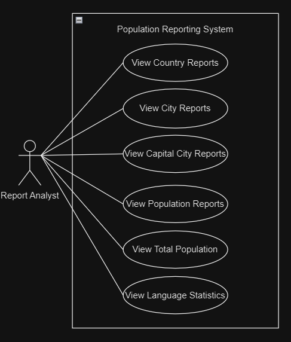

# Group 11 – Sprint 1 Use Cases

**Project:** Population Reporting System  
**Module:** SET09803 – DevOps  
**Scope:** Six Country Report requirements assigned to Sprint 1

These six documents describe the six individual Country Report features currently called from the Group 11 Java application. Each document follows the agreed use-case format: characteristic information, main success scenario, extensions, sub-variations and schedule.

## Sprint 1 Use-Case Index

| Use Case | Feature | GitHub Issue | Document |
|---|---|---|---|
| UC-01 | View All Countries by Population | #2 | [UC-01-All-Countries.md](use-cases/UC-01-All-Countries.md) |
| UC-02 | View Countries in a Continent by Population | #4 | [UC-02-Countries-By-Continent.md](use-cases/UC-02-Countries-By-Continent.md) |
| UC-03 | View Countries in a Region by Population | #6 | [UC-03-Countries-By-Region.md](use-cases/UC-03-Countries-By-Region.md) |
| UC-04 | View Top N Countries in the World | #7 | [UC-04-Top-N-World.md](use-cases/UC-04-Top-N-World.md) |
| UC-05 | View Top N Countries in a Continent | #8 | [UC-05-Top-N-Continent.md](use-cases/UC-05-Top-N-Continent.md) |
| UC-06 | View Top N Countries in a Region | #9 | [UC-06-Top-N-Region.md](use-cases/UC-06-Top-N-Region.md) |

## Overview Diagram

The overview diagram groups the system's reporting functionality into broader reporting categories. The six linked documents provide detailed use cases for the six Country Report requirements selected for Sprint 1.

## Implementation Notes

- `App.java` establishes the World database connection and calls `AutoDisplay.displayAllReports(...)`.
- `AutoDisplay.java` invokes Issue #2, #4, #6, #8, #9 and #7 in that actual execution order.
- The reports are printed to the **console**. The reviewed application does **not** include an interactive selection menu.
- The automatic demonstration uses **Asia**, **Eastern Asia**, and normally **Top N = 3**; only the world Top N (#7) supports a configurable value through `topN.world` or `TOP_N_WORLD` in the reviewed runner.
- `CountryReport.java` contains the shared SQL logic and `ReportDisplay.java` formats the output.

## Evidence for Review

Console-output screenshots for these six reports are stored in `docs/screenshots/` and linked to their corresponding requirements in `README.md`. These screenshots provide evidence of the implemented report functionality. A GitHub issue marked Done alone does not demonstrate that a requirement works.

**Release:** 1.0
